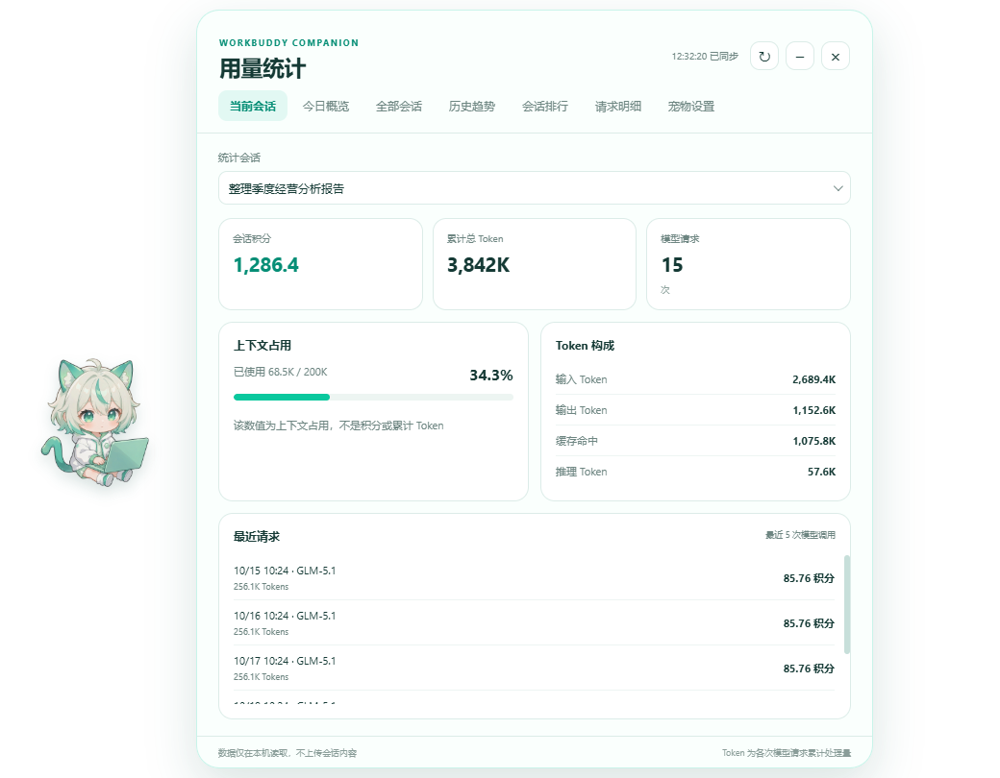
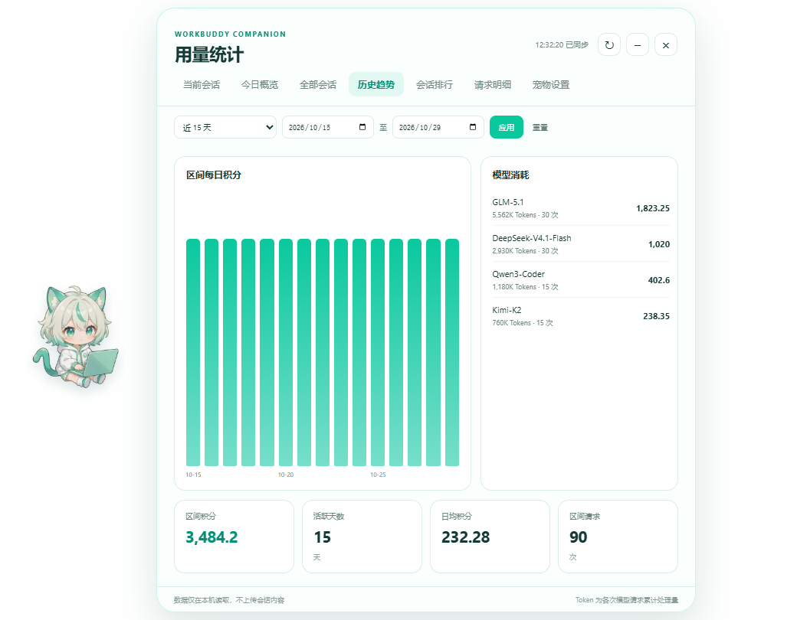
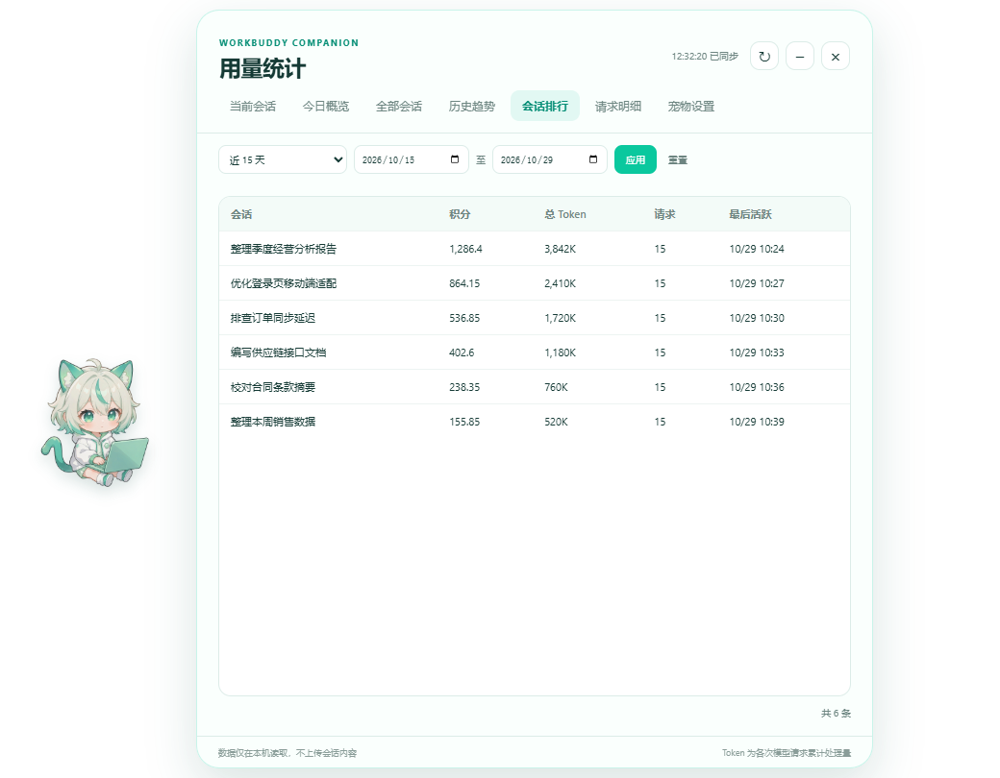
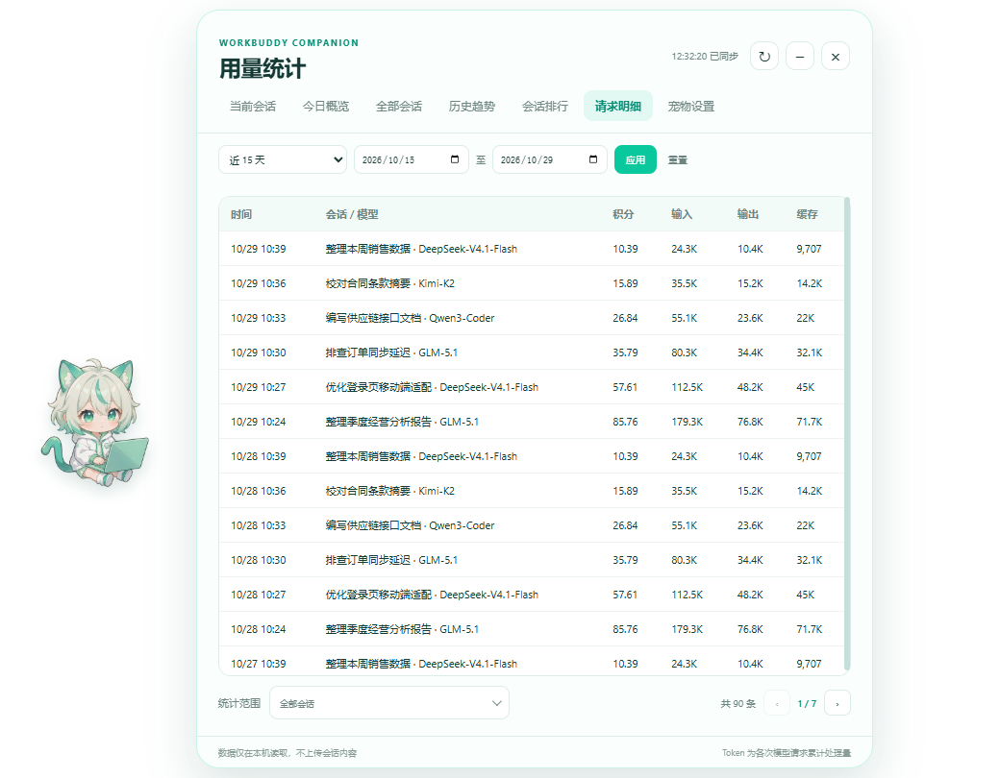

# WorkBuddy 小哇助手


一个读取 WorkBuddy 本地数据、在桌面显示用量统计的第三方社区小工具。

小哇平时是一只安静的桌面宠物，需要时再展开面板查看会话积分、Token 构成、历史趋势和请求明细。所有数据只在本机读取，不上传会话内容，不需要登录，也不依赖单独的业务服务器。

> 本项目是社区工具，不是 WorkBuddy 官方产品，与 WorkBuddy 官方无隶属关系。

产品主页：<https://xiaowa.xihrni.com>  
仓库地址：<https://github.com/xihrni/xiaowa-usage>

## 界面预览

<table>
  <tr>
    <td width="50%"><a href="docs/screenshots/current-session.png"></a><br><sub>当前会话：积分、Token 构成与最近请求</sub></td>
    <td width="50%"><a href="docs/screenshots/trends.png"></a><br><sub>历史趋势：每日积分与模型消耗</sub></td>
  </tr>
  <tr>
    <td width="50%"><a href="docs/screenshots/session-ranking.png"></a><br><sub>会话排行：按积分与 Token 对比</sub></td>
    <td width="50%"><a href="docs/screenshots/request-details.png"></a><br><sub>请求明细：按时间和模型查看</sub></td>
  </tr>
</table>

> 以上截图使用虚构演示数据，不包含真实会话内容。

## 功能

- **桌面宠物**：透明置顶，可拖动位置，收起后停留在系统托盘。
- **任务气泡**：处理中、完成、停止或失败时按状态提示；默认安静，避免频繁打扰。
- **会话统计**：单会话与全部会话的积分、Token、请求数、上下文占用。
- **今日概览**：今日消耗、活跃会话、模型分布和 Token 构成。
- **历史趋势**：按日期区间查看每日积分、模型消耗和区间汇总。
- **会话排行**：按积分排序，支持日期筛选与分页。
- **请求明细**：查看会话、模型、积分和 Token 明细，可按会话与日期筛选。
- **通知设置**：处理中提示、完成通知、后台任务通知、提示音和免打扰时段。
- **自动更新**：启动时检查 GitHub Release，确认后下载并重启安装。

## 安装

### 安装版

1. 打开 [GitHub Releases](https://github.com/xihrni/xiaowa-usage/releases/latest)；
2. 下载最新 `WorkBuddyPet-Setup-*.exe`；
3. 运行安装程序并按提示完成安装；
4. 安装后从桌面或开始菜单启动「WorkBuddy 小哇助手」。

安装版支持自定义安装目录、桌面与开始菜单快捷方式，以及通过 Windows「应用和功能」卸载。

### 便携版

下载 `WorkBuddyPet-*-win-x64.zip`，完整解压后双击 `WorkBuddyPet.exe`。

不要把 EXE 单独移出文件夹，DLL、`resources` 等文件需要保持完整。

### 系统要求

- Windows 10 或 Windows 11，x64；
- 本机已安装并登录 WorkBuddy；
- WorkBuddy 中至少创建过一次会话；
- 当前 Windows 用户有权限读取自己的 `~/.workbuddy` 数据目录。

## 隐私

- 只读取本机 WorkBuddy 数据库和会话用量信息；
- 不上传会话标题、消息内容、积分或 Token 数据；
- 不包含遥测、广告或远程统计服务；
- 不读取其他应用的数据；
- 设置与窗口位置仅保存在本机。

详细说明见 [隐私说明](PRIVACY.md)。

## 数据口径

- **积分**：读取 WorkBuddy 本地积分记录；
- **Token**：按模型请求记录累计；
- **上下文占用**：当前上下文窗口使用量，不是积分或累计 Token；
- **日期筛选**：趋势、会话排行和请求明细按请求日期统计；
- 无法关联到具体请求的积分，按会话最后活跃日期归入区间。

不同 WorkBuddy 版本的数据结构可能变化。遇到不兼容时，小哇会显示提示，而不是静默处理。

## 开发

```bash
git clone https://github.com/xihrni/xiaowa-usage.git
cd xiaowa-usage
npm install
npm start
```

检查本地数据读取：

```bash
npm run check
```

应用入口为 `src/main.js`，界面代码位于 `src/`，猫咪素材位于 `assets/`。

## 构建 Windows 安装包

项目包含 NSIS 安装脚本 `installer/WorkBuddyPet.nsi`。构建前需要准备 Electron 运行时和 NSIS，并将便携运行时放入 `release/WorkBuddyPet/`。

安装脚本使用 UTF-8 BOM 编码。中文界面在 NSIS 脚本缺少 BOM 时会出现乱码。

## 已知限制

- 目前仅支持 Windows x64；
- 本地数据口径取决于 WorkBuddy 自身记录，无法恢复未写入的数据；
- 日期区间内无法精确归属的积分按最后活跃日期计算；
- 未签名版本可能触发 Windows SmartScreen 提示；
- WorkBuddy 数据结构升级后可能需要更新适配。

## 常见问题

见 [FAQ](docs/FAQ.md)。

## 更新与发布

- [自动更新说明](docs/UPDATES.md)
- [发布流程](docs/RELEASING.md)
- [Windows 代码签名](docs/CODE_SIGNING.md)

## 参与贡献

欢迎通过 Issue 反馈兼容性问题、功能建议和界面问题。提交前请阅读 [贡献指南](CONTRIBUTING.md) 和 [行为准则](CODE_OF_CONDUCT.md)，并避免附带真实会话内容或个人数据。

安全问题请按 [安全说明](SECURITY.md) 私下反馈。

## 许可

代码使用 [MIT License](LICENSE)。

角色形象与美术素材不属于 MIT 代码许可范围，版权归素材提供者所有，未经许可请勿单独提取用于其他项目。
